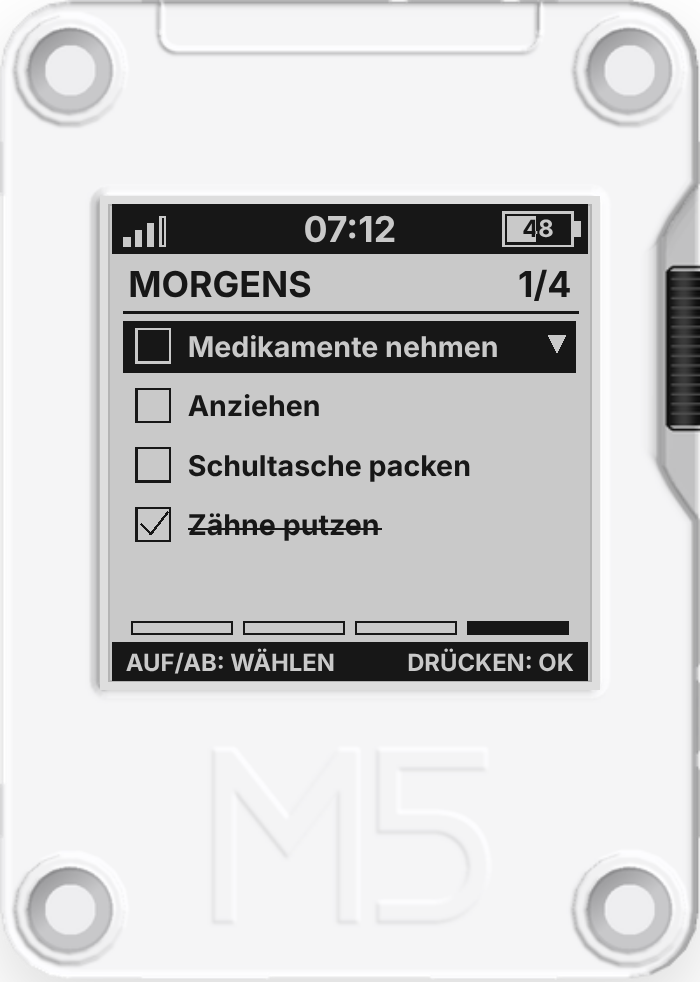
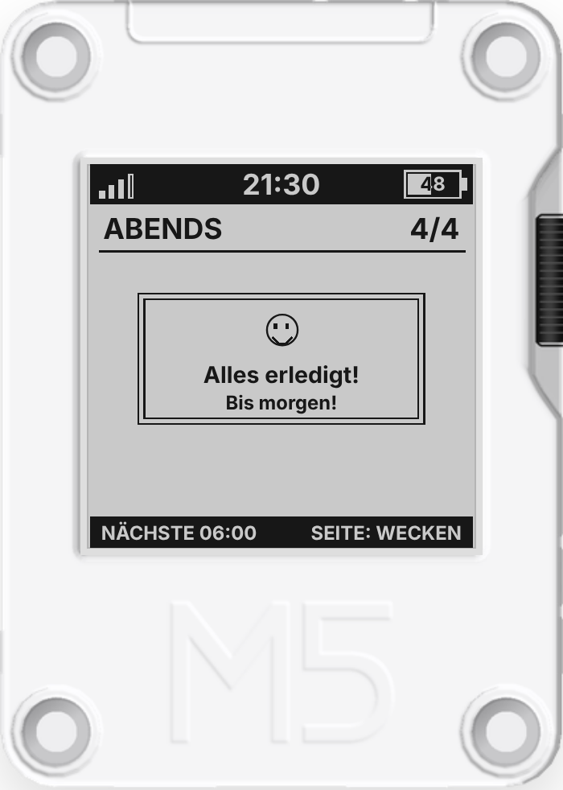
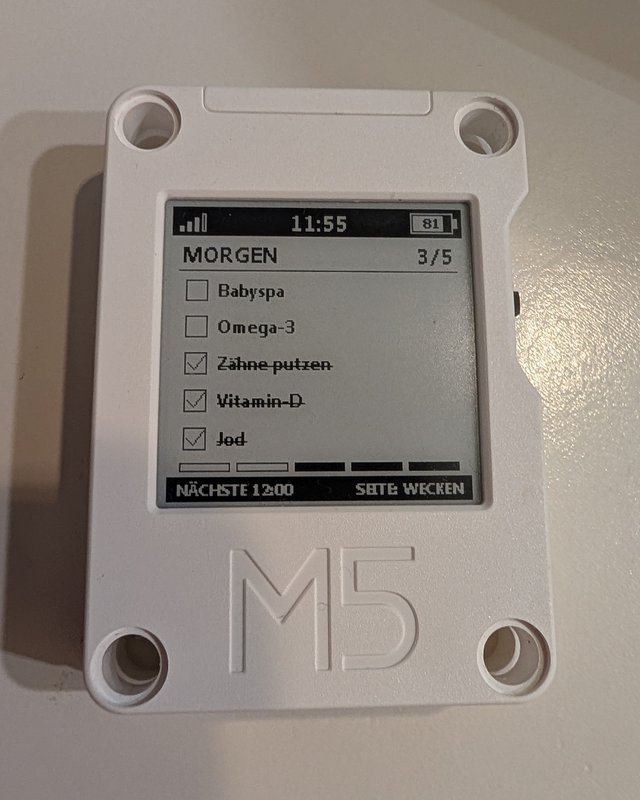
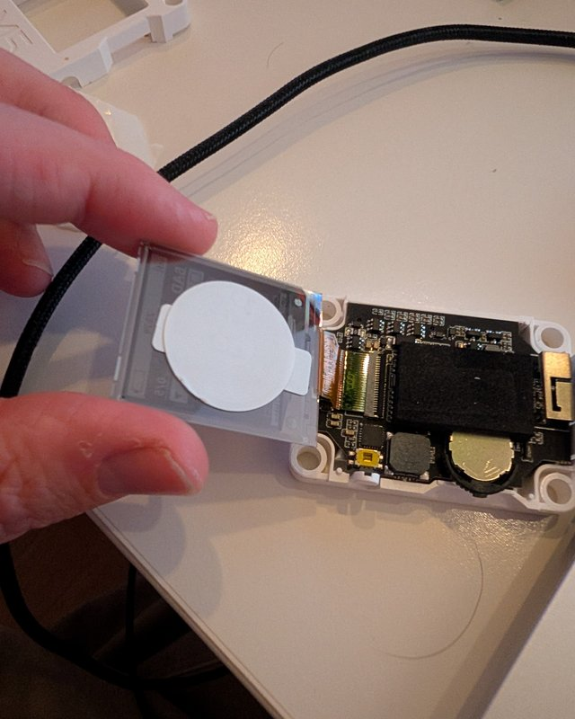

# 3310-eink — CoreInk todo & clock for Home Assistant

Retro Nokia 3310-inspired monochrome e-paper projects for the M5Stack CoreInk, ESPHome, Home Assistant and MQTT: `todo_3310` (one checklist per daypart, deep sleep between dayparts) and `clock_3310` (live clock, powered continuously without deep sleep).

<p align="center">
  <a href="https://3djupp.github.io/3310-eink/"></a>
  &nbsp;
  <a href="https://3djupp.github.io/3310-eink/"></a>
</p>

<p align="center"><b><a href="https://3djupp.github.io/3310-eink/">▶ Try the interactive demo</a></b><br>
Press the device buttons, switch dayparts, language and battery level. The screen is drawn from the same 200 × 200 pixel coordinates as the firmware.</p>

> **Status: experimental.** Both firmware files pass `esphome config` and `esphome compile` with ESPHome 2026.10, and `todo_3310` runs daily on the author's CoreInk. It has not been tested on other setups yet, so run ESPHome Validate before flashing.

## On real hardware

<p align="center">
  
  &nbsp;
  
</p>

Left: the sleep image after the morning, with the next wake time and `SEITE: WECKEN` at the bottom. Right: in my build a passive NFC sticker sits behind the e-paper panel inside the case. Holding a phone to the front of the device opens the dashboard view in the Home Assistant app; see [NFC tag in the deployment guide](docs/DEPLOYMENT.md#optional-nfc-tag-on-the-case-opens-the-dashboard). The CoreInk itself does not read NFC, the sticker works on its own.

## What it does

- Three dayparts (default morning 06:00, midday 12:00, evening 18:00), each with its **own list of up to five tasks**, a title and a message for the finish card.
- The display language (German or English) is switched in Home Assistant, no reflash needed. Both firmware variants default to German.
- The CoreInk wakes at the start of each daypart and shows that daypart's list. A new day starts with the first daypart: then all three lists are reset. Between dayparts it sleeps; the side button wakes it at any time.
- Tasks are managed in three Home Assistant **to-do lists**, so you add, rename, reorder and check tasks with the normal to-do card, the companion app or voice.
- Checking a task on the device updates the HA list and the other way round (the device picks up HA changes on its next wake).
- Once every task of the current list is done, the list is locked: the finish card stays and UP, DOWN and PRESS do nothing. TOP can undo only the most recent toggle of the same wake, for a slip on the last task.
- While asleep the screen shows the next wake time and `SIDE: WAKE`; it is drawn with a full refresh right before sleep, which also clears ghosting from the moving selection bar.
- Battery voltage/percentage, MQTT availability, last-seen timestamp and the seconds until the next wake are reported to HA.

## Repository layout

- [`esphome/todo_3310.yaml`](esphome/todo_3310.yaml) — firmware for the daypart checklist
- [`esphome/clock_3310.yaml`](esphome/clock_3310.yaml) — firmware for the always-on clock
- [`homeassistant/packages/todo_3310.yaml`](homeassistant/packages/todo_3310.yaml) — HA helpers, MQTT entities, scripts and automations
- [`homeassistant/dashboards/todo_3310.yaml`](homeassistant/dashboards/todo_3310.yaml) — example dashboard view to manage the lists, schedule and device status
- [`examples/secrets.example.yaml`](examples/secrets.example.yaml) — secret key names for both firmware variants
- [`docs/DEPLOYMENT.md`](docs/DEPLOYMENT.md) — installation steps
- [`docs/ARCHITECTURE.md`](docs/ARCHITECTURE.md) — MQTT contract and sync behavior
- [`docs/BACKLOG.md`](docs/BACKLOG.md) — open work
- [`mockup/index.html`](mockup/index.html) — source of the live demo; the root [`index.html`](index.html) forwards the GitHub Pages start page to it
- [`docs/images/`](docs/images) — demo screenshots and hardware photos used in this README

## Quick start

1. Configure an MQTT broker reachable by Home Assistant and the CoreInk.
2. In Home Assistant, add the **Local To-do** integration three times with the names `todo_3310 Morning`, `todo_3310 Midday` and `todo_3310 Evening`.
3. Copy `homeassistant/packages/todo_3310.yaml` to your HA `config/packages/` folder and make sure packages are enabled in `configuration.yaml`:
   ```yaml
   homeassistant:
     packages: !include_dir_named packages
   ```
   Merge this into an existing `homeassistant:` block; do not create a duplicate key.
4. Validate and restart Home Assistant.
5. Open a dashboard, add or edit a view, choose **Edit in YAML** and replace its content with `homeassistant/dashboards/todo_3310.yaml` (the file is one view, not a whole dashboard).
6. Copy `esphome/todo_3310.yaml` into ESPHome, add the font file and local secrets (see the [deployment guide](docs/DEPLOYMENT.md)).
7. Run ESPHome Validate and resolve errors before flashing.
8. After the first wake, check that `todo_3310/state/config_applied` is published and the lists show up on the device.

## Firmware variants

- **`todo_3310`** — generic, time-aware task list. The example tasks (brushing teeth, medication, plants, mail) are only examples; a children's bathroom routine is one possible use, not a fixed task set.
- **`clock_3310`** — clock using local time, intended for continuous USB or power-adapter operation; no deep sleep, with API and OTA for updates.

## About the demo

The demo screen is an SVG with a 200 × 200 viewBox that reuses the pixel coordinates from the firmware display lambdas, so it scales with the device frame at any window width. Text uses browser fonts with the firmware's line metrics, so text widths are approximate. The device shell is a CSS illustration inspired by the M5Stack CoreInk, not a product photograph, and the page is a layout approximation, not a hardware screenshot.

## Known limitations

- Three dayparts and up to five tasks per daypart. Longer HA lists are cut to their first five items.
- Dayparts repeat daily; there are no weekday or calendar rules.
- `seconds_to_wakeup` is calculated before sleep and is not a live countdown.
- A sleeping ESP32 cannot receive an immediate update; HA changes apply on the next wake/connect.
- If a task is changed on the device and in HA while they cannot talk to each other, the last change to arrive wins.
- Every wake starts with a full e-paper refresh (the panel loses its image memory in deep sleep); partial refreshes are used for button presses while awake. Ghosting and battery life still need hardware testing.

## Security

Never commit real `secrets.yaml`, Wi-Fi credentials, MQTT passwords, API encryption keys or certificates. Keep the broker authenticated and restricted to your local network.

## Support

If this project is useful to you, you can support its development:

<p>
  <a href="https://ko-fi.com/3djupp"></a>
  <a href="https://buymeacoffee.com/3djupp"></a>
</p>

## License

MIT. See [LICENSE](LICENSE).
